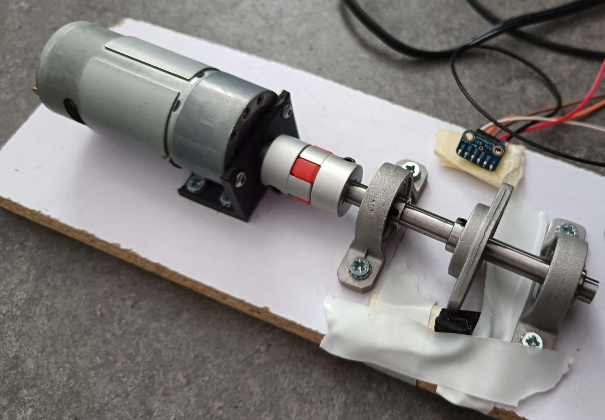
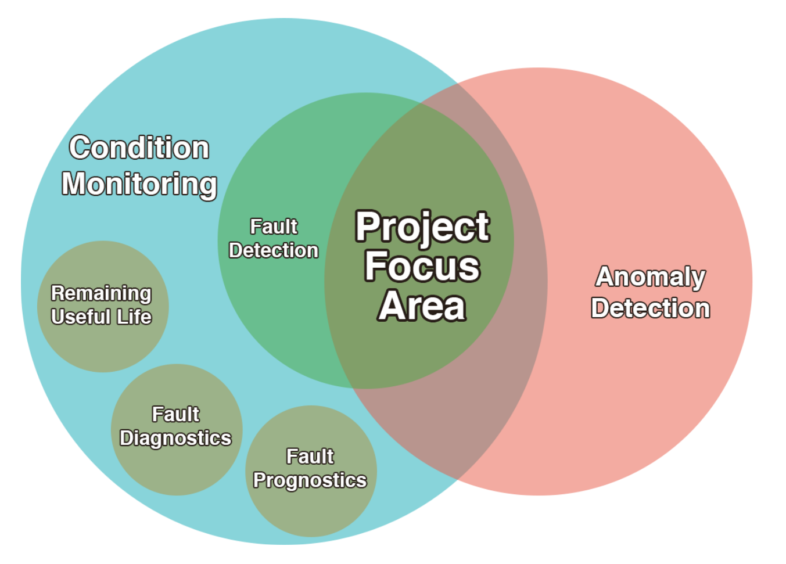

[Back](../)

## Sensor System for Industrial Predictive Maintenance

My master's dissertation, developed within the [GreenAuto](https://www.agendagreenauto.pt/projeto/) project. I designed a wireless sensor system that monitors the condition of industrial machines through vibration, sound and temperature, so that predictive maintenance can be applied to older equipment that was never built with sensors in mind.

The targets were Automated Guided Vehicles and the machines around them, which meant the modules had to be cheap and small enough to be added to equipment already in service. I built the firmware on Teensy and ESP-12E microcontrollers, with two accelerometers, a digital microphone, an analogue ultrasonic microphone and an infrared temperature sensor. The modules recorded raw one-second samples to an SD card, and I computed time-domain features from them afterwards. I chose these features over the FFT because they are small and simple enough to move onto the microcontroller later, which would keep the wireless traffic down.

To test the system, I built three small testbeds, each a DC motor turning a shaft on ball bearings, and recorded them with a healthy bearing and one with part of its lubricant removed. XGBoost found the faulty bearing almost every time, with an F1 of 0.99, even when only 9% of the samples were faults. This is one known fault in a lab, though, with about a hundred faulty samples to test on. The harder test was a testbed the model had never seen, where the best model reached an F1 of 0.74. The unsupervised models (One-Class SVM, Isolation Forest and Local Outlier Factor) did not work, as most of the samples they flagged were false alarms. I also compared sensors at different price points, to see how much detection performance the cheaper components actually cost.

You can read the full dissertation here: [Dissertation](/documents/SensorSystemForPredictiveMaintenanceInIndustrialEnvironments.pdf). For a more condensed version, check out the [slides](/documents/Dissertation_Presentatio.pdf) for the presentation.

### Tech Explored

#### Embedded Systems

- Accelerometers, microphones (analogue, digital, ultrasonic), IR temperature sensors
- Microcontrollers (Teensy, ESP-12E), ADC, EEPROM, SD card
- WiFi communication, level shifting
- Custom hardware testbeds

#### Signal Processing

- Time-domain features (RMS, kurtosis, crest factor and others)
- Discrete and Short-Time Fourier Transforms (DFT, STFT)
- Wavelet, Empirical Mode, and Hilbert-Huang Transforms
- Envelope detection, signal filtering, time-frequency analysis

#### Machine Learning & Data Analysis

- Time-series preprocessing, outlier removal
- Supervised models: XGBoost, Random Forest, AdaBoost, k-NN, SVM
- Unsupervised models: Isolation Forest, One-Class SVM, Local Outlier Factor
- Anomaly detection, dataset creation, evaluation metrics

#### Software & Infrastructure

- Firmware design with finite state machines
- SD card logging, serial link to the ESP-12E for WiFi
- Time-series database tests (InfluxDB), model automation scripts

#### Research & System Design

- Predictive vs. preventive vs. reactive maintenance
- Sensor selection and cost-performance analysis
- Integration with legacy industrial systems

### Highlights

- Got to work on several different layers:
  - Sensor selection
  - Firmware development
  - Data analysis
  - Machine Learning
  - Databases
- Very satisfying to work on a brand new project.
- Research is cool. Felt like I was doing work that can be useful for the future.
- Biggest project to date.

### Lowlights

- I only noticed that there was a typo in the title the day before presenting the dissertation. Still feel a bit embarrassed.
- I didn't have a lot of support, so I felt a bit lost, especially in the beginning.
- Researching related concepts was challenging due to significant overlap and subtle differences between them. To clarify these relationships, I even created a diagram that maps out how the concepts connect:

### Lessons Learned

- You can't do everything. You can't test everything. Exploration is crucial, but it has to end at a certain time. Otherwise, you'll be stuck in the universe of possibilities.
- Code becomes legacy the moment it is written.
- One looks at a million datasets, but none ever truly matches your expectations.
